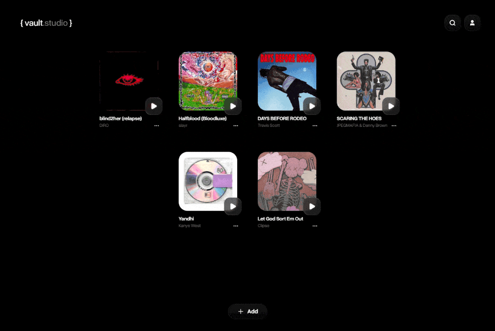
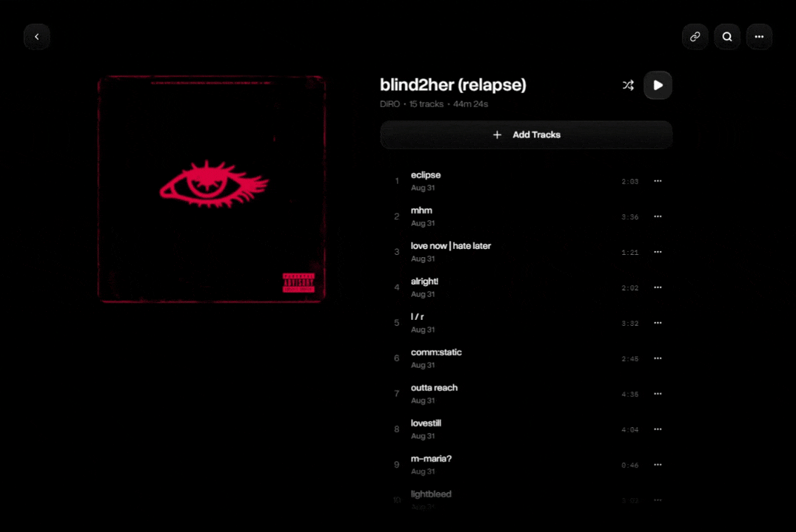
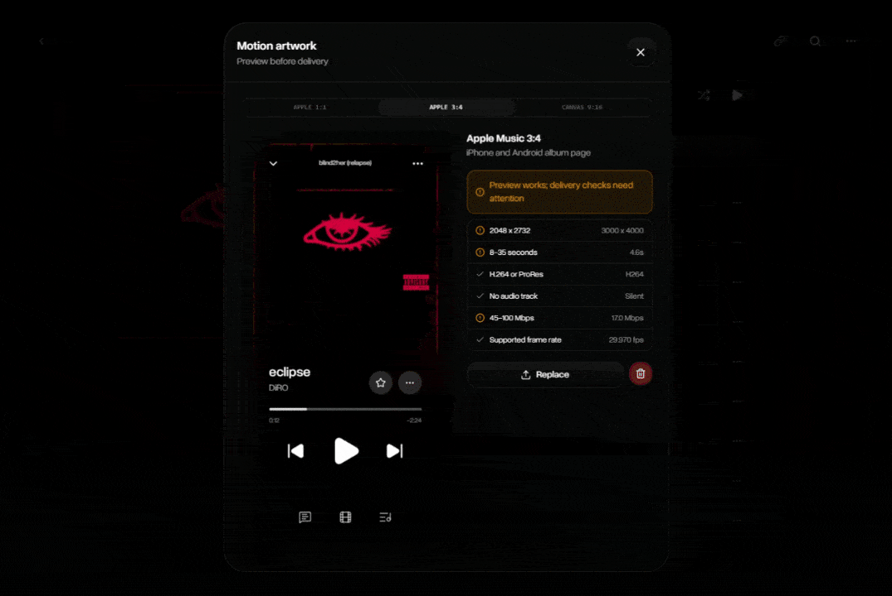
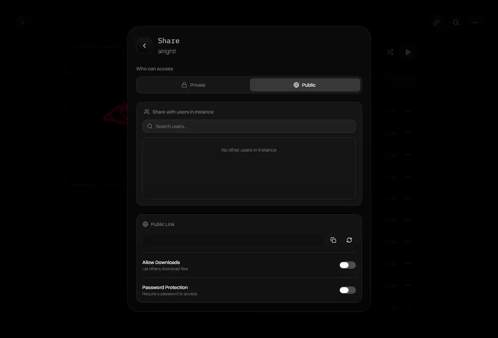
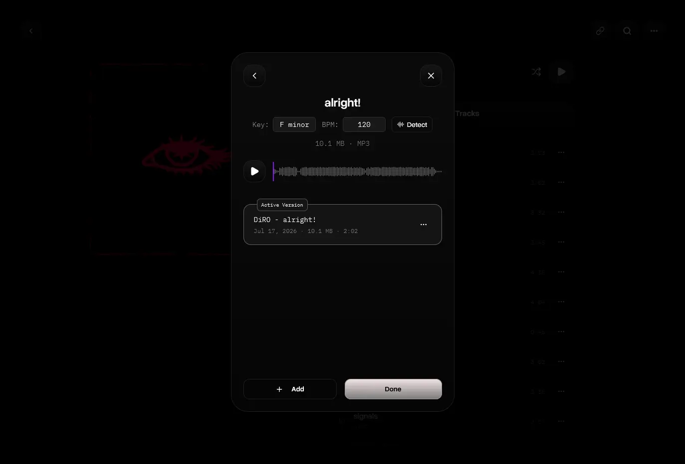
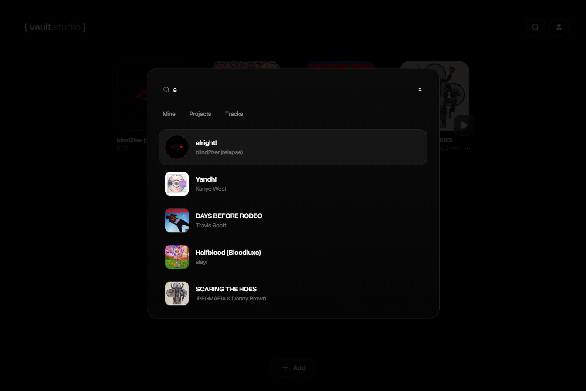
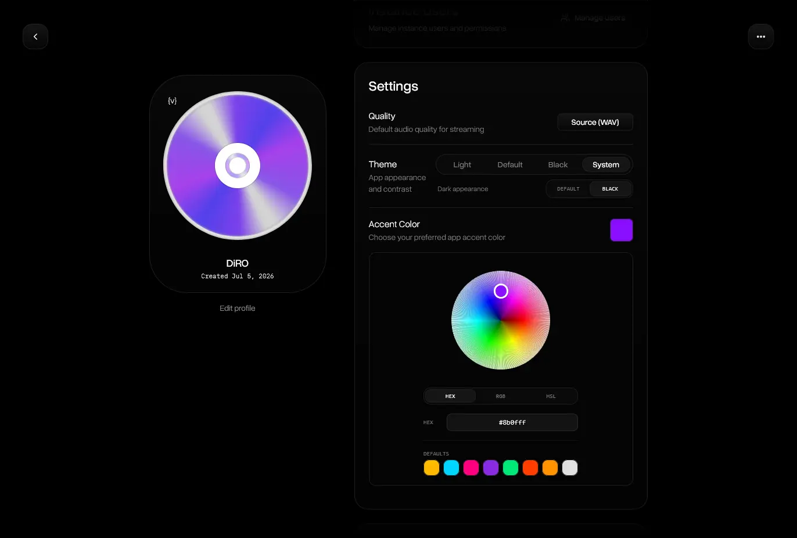

<div align="center">


# { vault.studio }

**An artist-focused fork of [{ vault }](https://github.com/bungleware/vault).**

Self-hosted streaming, organization, and creative tools for work-in-progress music.

[](https://github.com/ILostXD/vault_studio/releases/latest)
[](LICENSE)
[](https://github.com/bungleware/vault)



<details>
  <summary>More screenshots</summary>
  
  
  
  
  
  
</details>

<sub><em>Demo media notice: the projects shown in these GIFs are not my work and appear only to demonstrate the interface. They include DAYS BEFORE RODEO, Halfblood (Bloodluxe), SCARING THE HOES, Yandhi, Let God Sort Em Out, and blind2her (relapse). All rights remain with their respective artists and rights holders.</em></sub>

</div>

## About This Fork

`{ vault.studio }` is an independent, artist-focused fork of [{ vault }](https://github.com/bungleware/vault) by [bungleware](https://github.com/bungleware). The original developer created the core application and the large majority of its foundation. This fork builds on that work with additional tools for artists, demos, and mobile listening; it is not intended to diminish or replace the upstream project.

The project is also inspired by [untitled](https://untitled.stream/), while remaining open source and self-hosted.

## What { vault.studio } Adds

- Native Android app with a selectable self-hosted backend URL, including raw HTTP support for local networks
- Android media controls and track metadata for the notification player and connected devices
- Automatic BPM and musical-key analysis, plus manual re-detection
- Rich per-track notes with formatting and autosave
- Mobile voice-memo capture that uploads ideas directly into a project
- Animated artwork management and previews for Apple Music `1:1` and `3:4` motion artwork and Spotify Canvas `9:16` video
- Release preparation with reusable credits, validation, distributor-ready ZIP packages, and Too Lost draft delivery
- Export & Library: tagged FLAC or MP3 albums with embedded cover art, untouched raw masters, and one-click publishing to a server music library for Navidrome, Jellyfin, or Plex
- Per-project audio tags (album, artist, album artist, genre, year, per-track overrides) with a reusable "usual genre" in your artist profile
- Redesigned fullscreen player with an animated artwork backdrop and a single rail for queue, notes, and comments
- Light, Default, Black, and System themes with a configurable accent color, or a dynamic accent taken from the playing album's cover
- Mobile-focused layouts, edge-to-edge Android presentation, and gesture-aware navigation

## Guides

Longer explanations live in their own docs:

- [Release preparation and distribution](docs/release-distribution.md): release packages, Too Lost drafts, and setup
- [Export and music library](docs/export-and-library.md): tagged FLAC/MP3 exports and publishing to Navidrome, Jellyfin, or Plex
- [Audio metadata](docs/audio-metadata.md): tag resolution and library setup details
- [Motion artwork preview](docs/motion-artwork.md): Apple Music and Spotify Canvas previews
- [Self-hosting guide](docs/self-hosting.md): updating, in-app updates, and every configuration variable
- [Development](docs/DEVELOPMENT.md)

## Core { vault } Features

These features come from the upstream project and remain central to this fork:

- Store and stream audio projects and track versions
- Invite users and collaborate within one instance
- Share projects and tracks publicly with download, password, and permission controls
- Organize projects in nested folders
- Export and import an instance as a ZIP backup

## Install

### Android

Download the APK from the [latest GitHub release](https://github.com/ILostXD/vault_studio/releases/latest). Android may ask you to allow installs from your browser or file manager.

On first launch, enter the full URL of your self-hosted instance, including `http://` or `https://` and its port when required.

### Self-hosted Server

Requires Git, Docker, and Docker Compose.

```bash
git clone https://github.com/ILostXD/vault_studio.git
cd vault_studio
cp .env.example .env
```

Set `JWT_SECRET`, `SIGNED_URL_SECRET`, and `TOKEN_PEPPER` in `.env` to different random values (`openssl rand -base64 32` generates one), then start it:

```bash
docker compose up -d --build
```

The app is available at `http://localhost:8080` by default and stores its data in `./data`. See the [self-hosting guide](docs/self-hosting.md) for updates, in-app updates, and all configuration options.

## Credits And License

Most of the original application was created by [bungleware](https://github.com/bungleware) and the [{ vault } contributors](https://github.com/bungleware/vault/graphs/contributors). Fork-specific additions are maintained in this repository. See the Git history for a complete attribution trail.

The animated fullscreen artwork background was informed by Aadish Verma's research, [Reverse engineering Apple Music's background gradient](https://www.aadishv.dev/music). { vault.studio }'s implementation was written independently using the existing React and CSS animation stack.

This project remains available under the [GNU Affero General Public License v3.0](LICENSE). Parts of this fork were developed with coding-model assistance; see [CONTRIBUTING.md](CONTRIBUTING.md) for the project policy.
